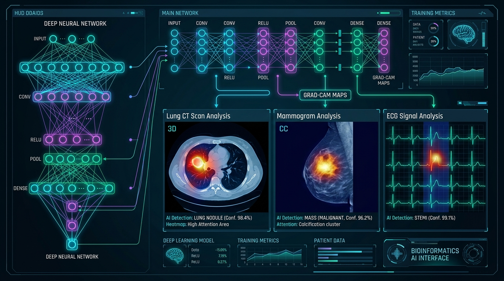

# Md. Ferdous Jaman — Professional Portfolio Website



Live Personal Portfolio Website for **Md. Ferdous Jaman**, Computer Science & Engineering graduate from Daffodil International University (CGPA 3.80/4.00), Web Developer at **ElyXen**, and published researcher with **6 peer-reviewed papers** across Elsevier Scopus Q1 and IEEE Xplore.

---

## 🌟 Features & Highlights

- **Hero & Profile**: Headshot portrait, animated gradient badge, dynamic role typewriter cycler, and quick contact action buttons.
- **Scientific Publications Showcase**:
  - Spotlight for **Elsevier Scopus Q1 Journal** paper in *Informatics in Medicine Unlocked* (CiteScore: **10.5**).
  - 5 IEEE Xplore conference papers in medical AI, ECG diagnostics, leukemia, lung cancer, and stroke detection.
  - Interactive category filters: *All (6)*, *Elsevier Q1 Journal*, *IEEE Xplore Conferences*, *Cancer AI*, and *Explainable AI (Grad-CAM/LIME)*.
  - Direct DOI links to publisher pages and an interactive **BibTeX Citation Modal** with one-click clipboard copy.
- **Featured Projects**: Detailed showcases for **Feriwala** (Marketplace with 50+ user testing), **Lifeline** (React Native & Supabase medical app), and **BuildNest** (3NF MS SQL expenditure management system).
- **Interactive Skills Matrix**: Grouped proficiencies across Programming Languages, Web & Mobile, Databases, ML & Healthcare AI, SQA & STLC, and Tools.
- **Experience & Education**: Timeline detailing web development at ElyXen, DIU B.Sc. in CSE (Dean's List Top 0.5%), and 4x Board Scholarships (Golden A+ 5.00).
- **Academic References**: Formal contact cards for faculty mentors.
- **Resume Download**: One-click download of the official curriculum vitae PDF (`assets/Md_Ferdous_Jaman_Resume.pdf`).
- **Interactive Theme**: Instant switching between **Dark Obsidian** and **Clean Light** modes with saved preferences.
- **Zero-Dependency Architecture**: Built using pure, modern Vanilla HTML5, CSS3, and JavaScript ES6+ for performance and cross-device responsiveness.

---

## 🚀 How to Run Locally

### Option 1: Open Directly
Simply open `index.html` in any modern web browser (Google Chrome, Microsoft Edge, Firefox, etc.).

### Option 2: Run Local Server
On Windows:
```powershell
powershell -ExecutionPolicy Bypass -File server.ps1
```
Or double-click `start-server.bat`. Then visit: `http://localhost:8080/`.

---

## 📬 Contact & Connect

- **Name**: Md. Ferdous Jaman
- **Location**: Mirpur, Dhaka, Bangladesh
- **Email**: [ferdousjamanmim@gmail.com](mailto:ferdousjamanmim@gmail.com)
- **Phone**: +8801612018416
- **GitHub**: [github.com/ferdous-jaman](https://github.com/ferdous-jaman)
- **LinkedIn**: [linkedin.com/in/ferdousjaman](https://linkedin.com/in/ferdousjaman)
